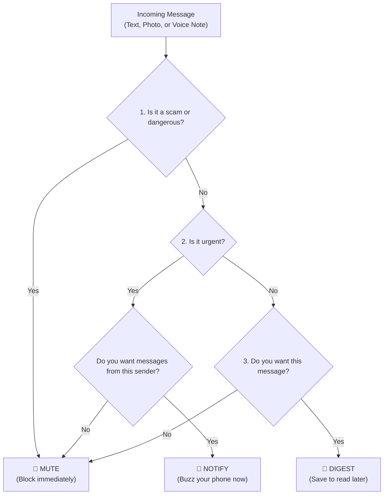

# Smart Message Notification Filter

An AI assistant that sorts your incoming WhatsApp messages so your phone only buzzes when it really matters. It understands text messages, photos/posters, and voice notes.

---

## 📱 The Problem

Every day, we get flooded with dozens or hundreds of messages:
- Urgent messages from family or work
- Regular group chats and school/neighborhood updates
- Store promotions and sale flyers
- Dangerous scams and fake links

When your phone buzzes for everything, you get overwhelmed. Worse, you might miss an urgent message or accidentally fall for a scam.

---

## 💡 What This Project Does

This system looks at every incoming message and automatically picks one of three actions:

1. **🔔 Notify (Buzz Now)**: Important or time-sensitive messages that need your attention right away (like family emergencies, urgent work questions, or important delivery updates).
2. **📰 Digest (Read Later)**: Useful messages that are not urgent (like neighborhood announcements, general group chats, or interesting newsletters). These are bundled into a summary so you can read them when you're free.
3. **🔕 Mute (Silence Completely)**: Junk, spam, unwanted promotions, and dangerous scams. Your phone stays quiet, and you don't waste time on them.

---

## 🧠 How It Makes Decisions

Instead of guessing, the AI checks three simple questions for each message:



1. **Is it safe?**
   If a message looks like a phishing scam, a fake bank link, or a trick, it is instantly **muted**. Safety always comes first.
2. **Do you care about it?**
   It looks at your past habits. If you usually reply to this person or business, it marks the message as wanted. If you always ignore or report them, it silences them.
3. **Is it urgent?**
   Does it need an answer today, or can it wait until tonight or the weekend?

---

## 🛡️ Built-in Safety Rules (No AI Guesswork)

For critical security, the system has strict automatic safety rules that cannot be bypassed:

- **Fake Banks & Impersonation**: If an unverified sender claims to be your bank, it is muted immediately.
- **Asking for Passwords / OTPs**: Any message asking for an OTP, password, or PIN is blocked.
- **High-Pressure Money Demands**: Urgent requests to send money from people you don't know are muted.
- **Unsubscribe / Opt-Out**: If you previously told a business to stop messaging you, any new ads from them are silenced.
- **Tricky Instructions**: If a message contains hidden text trying to trick the AI into approving it, the trick is caught and the message is muted.

---

## 📂 Project Structure

```text
.
├── code/
│   ├── main.py                  # Main program to run the filter
│   ├── config.py                # Settings and options
│   ├── agent/                   # AI logic, prompts, and tool rules
│   ├── context/                 # Gathers sender details, voice note audio, and images
│   ├── guards/                  # Safety rules and scam blockers
│   ├── output/                  # Saves the final results cleanly
│   ├── evaluation/              # Tools to test how well the AI performed
│   └── tests/                   # Automated unit tests
├── dataset/                     # Sample messages, users, and groups to test with
│   ├── media/                   # Voice note audio files and flyer photos
│   └── output.csv               # The result file with every decision
├── requirements.txt             # Required Python tools
└── .env.example                 # Example file for your API keys
```

---

## 🚀 Quick Start Guide

### 1. Requirements
- Python 3.11 or newer
- API keys for:
  - **Anthropic** (used for understanding the message and making decisions)
  - **OpenAI** (used for converting voice notes into text)

### 2. Setup

Open your terminal and run:

```bash
# 1. Clone this project
git clone https://github.com/<your-username>/message-notification-router.git
cd message-notification-router

# 2. Create a virtual environment
python -m venv .venv

# 3. Activate the environment
# On Windows:
.venv\Scripts\Activate.ps1
# On Mac / Linux:
source .venv/bin/activate

# 4. Install the required packages
pip install -r requirements.txt
```

### 3. Add Your API Keys

Create a `.env` file by copying the template:

```bash
cp .env.example .env
```

Open `.env` in any text editor and paste your keys:

```text
ANTHROPIC_API_KEY=your-anthropic-key-here
OPENAI_API_KEY=your-openai-key-here
```

---

## 🏃 Running the Program

### Process All Messages
Run the main script to categorize all messages in the dataset:

```bash
python code/main.py
```

### Helpful Options

- **Test without spending API money (`--dry-run`)**:
  Checks that all files, images, and tools are working without calling any paid AI service:
  ```bash
  python code/main.py --dry-run
  ```

- **Run just the first few messages (`--limit N`)**:
  Test on 5 messages to see how it works quickly:
  ```bash
  python code/main.py --limit 5
  ```

- **Resume an interrupted run (`--resume`)**:
  If your internet cuts out or you stop the script, this picks up right where you left off:
  ```bash
  python code/main.py --resume
  ```

---

## 📊 What the Output Looks Like

The results are saved to `dataset/output.csv` with a clear decision and a short human-readable reason for every message:

| message_id | action | message_type | reason | confidence |
|---|---|---|---|---|
| `msg_101` | **notify** | `personal_chat` | Family member asking for emergency help with car breakdown. | 0.95 |
| `msg_102` | **digest** | `community_update` | Apartment association monthly meeting schedule for next Sunday. | 0.88 |
| `msg_103` | **mute** | `scam` | Unknown sender asking for credit card details to claim a fake lottery prize. | 0.99 |

---

## 🧪 Testing

To run the automated tests and make sure the safety rules and code are working:

```bash
python -m pytest code/tests -q
```

---

## 📄 License

This project is licensed under the MIT License.
